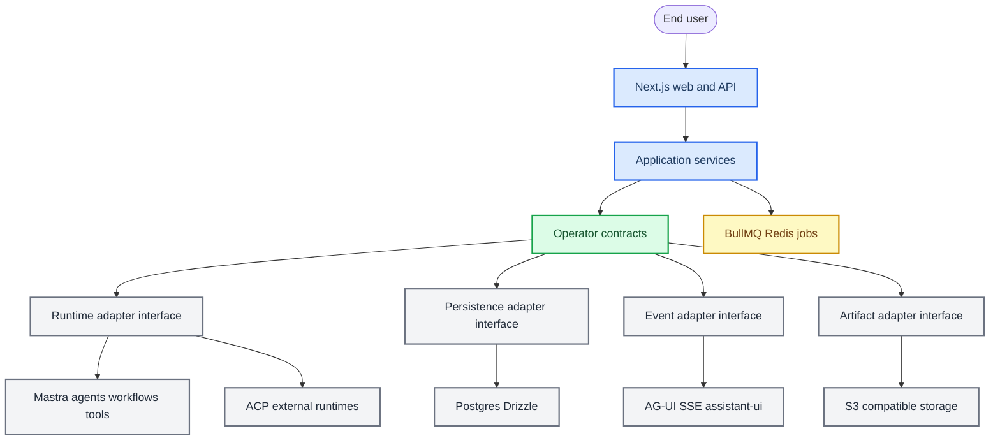

# 算子平台薄产品契约重构计划

_本计划遵循根目录 `AGENTS.md`、`CLAUDE.md` 和 `docs/DEVELOPMENT_STANDARD.md`。详细接口与迁移规则见 `docs/specs/Operator_Thin_Product_Contracts_Spec.md`。_

---

## 文档定位

Operator 当前是一个云端垂直智能体 MVP：终端用户提交任务，平台通过 Mastra/ACP 调度 Codex CLI、Claude Code、OpenHands、DeepSeek-backed runtime 等成熟 agent，并加载 GitHub 开源 skill、workflow 和工具，最终交付文件产物。

因此，本轮重构的目标不是建设一个厚重的自研 agent runtime 或 workflow engine，而是把 Operator 必须自研的最小产品语义抽成薄契约层。成熟框架已经提供的能力继续交给成熟框架，Operator 只维护任务、运行、消息、产物、scope、权限、审计和计费这些产品语义的边界。

重构完成后，应满足：

- Web、Mastra、ACP、DB、AG-UI、前端恢复逻辑都依赖同一套 Operator 产品契约
- 产品契约不 import Mastra、Next.js、React、AG-UI、Drizzle 或 Node runtime 类型
- route、component、runtime adapter 中不再各自定义状态值、消息边界和产物规则
- run 终态、消息、artifact、task snapshot 的事实来源一致
- MVP 自研代码收缩到必要范围，框架能力通过 adapter 使用

## 根因判断

过去一百多次提交中，大量用户可见问题集中在任务生命周期、前端恢复、消息 ID、artifact 链路和 runtime 结果落库。代表性修复包括：

- `4956543`：修复 chat output 未按 run 隔离
- `8317f21`：修复 message id protocol
- `5d8dc68`、`8a4bed1`、`0407959`、`aff6c85`：连续修复运行中状态、task event、刷新恢复和多轮任务判定
- `0f2a4a5`、`a04110c`：修复 route 中 lifecycle 终态、stream 断开和 artifact 注册阻塞风险

这些问题不是 Mastra、ACP、AG-UI、Drizzle 本身不成熟，而是 Operator 自己的薄产品契约没有独立定义并强制引用。当前状态、消息、task snapshot、chat result、artifact contract 分散在多个层级中，导致每个修复都容易补到局部文件，而不是统一修复同类问题。

## 核心决策

本轮不新增厚重的 `operator-domain`。改为新增薄契约包：

```text
packages/operator-contracts/
```

该包只负责：

- 类型与 schema
- 状态枚举和状态判定函数
- 标准错误码
- 消息、运行、产物、scope、task snapshot 的 DTO
- adapter 输入输出接口
- 少量纯函数 mapper 和 validator

该包不负责：

- 不实现 runtime
- 不实现 workflow engine
- 不实现 queue/reconciler 调度
- 不实现 DB 查询
- 不实现对象存储
- 不实现 AG-UI 协议
- 不实现 React 状态恢复
- 不读取环境变量

## 目标架构



### Operator 自研层

Operator 自研层只保留产品控制面：

| 自研对象 | 保留原因 | 不应包含 |
|---|---|---|
| `RunContract` | 用户任务是否 queued/running/succeeded/failed/cancelled 是产品事实 | runtime 执行细节 |
| `TaskSnapshot` | 前端和 API 需要统一读取当前任务事实 | React 状态、AG-UI 原始事件 |
| `MessageContract` | 多轮任务必须以 user turn 和 run id 划边界 | assistant-ui 内部类型 |
| `ArtifactContract` | 用户最终购买的是产物交付 | S3 SDK、文件系统扫描实现 |
| `ScopeContract` | scope 是 Operator 的产品目录 | Mastra 注册对象本身 |
| `OperatorError` | 用户可理解的失败表达和审计 | 原始 provider stack trace |
| `AdapterResult` | 框架返回值进入产品层的边界 | Mastra/ACP/Drizzle 类型 |

### 外部框架层

成熟能力继续使用成熟实现：

| 能力 | 优先使用 |
|---|---|
| Agent、workflow、tool、workspace skill | Mastra |
| Codex CLI、Claude Code、OpenHands 等外部 agent | ACP |
| 后台任务、定时 reconciler | BullMQ/Redis |
| 前端 agent event 协议 | AG-UI、assistant-ui、Vercel AI SDK |
| 数据库 schema、事务、查询 | Postgres/Drizzle |
| 产物对象存储 | S3-compatible storage |
| 观测、trace、LLM 运行分析 | Mastra tracing、OpenTelemetry；Langfuse 作为外挂 backend |
| 身份认证 | OIDC/JWT/cookie 标准库 |

### 薄契约实现也优先用成熟工具

即使在 `@operator/contracts` 内部，也不应把通用机制全部自写。Operator 自研的是产品命名、状态含义、DTO 边界和策略，不是状态机引擎、事件规范、接口文档、观测系统或授权引擎。

| 薄契约能力 | 标准工具优先级 | Operator 保留的自研部分 |
|---|---|---|
| lifecycle transition | 优先评估 XState；至少保持 XState-compatible statechart | `RunStatus` 的产品含义和合法业务状态 |
| product event envelope | CloudEvents-compatible envelope | `type/data` 中的 Operator 业务事件内容 |
| DTO 和运行时校验 | Zod schema 作为单一校验源 | 字段语义、兼容策略和错误码 |
| REST API 契约 | OpenAPI | API 的产品资源命名和权限策略 |
| event/SSE/job 契约 | AsyncAPI | 事件主题、payload 语义和产品状态投影 |
| 后台调度 | BullMQ/Redis；长任务复杂后评估 Temporal/Inngest | reconciler decision、artifact retry policy |
| 前端流和消息 | AG-UI、assistant-ui、Vercel AI SDK | `TaskSnapshot` 和用户任务体验 |
| observability | OpenTelemetry、Mastra tracing；Langfuse 作为外挂 backend | 用户可见审计摘要和产品事件 |
| 认证 | OIDC/JWT/JWS、Auth.js、`jose`、opaque DB session | 用户、组织、登录产品策略 |
| 授权 | 简单产品权限；复杂后评估 Casbin/OpenFGA | Operator 资源、动作、套餐权益和审计策略 |

### MVP 落地取舍

第一版按“仓库内轻量依赖优先，生产基础设施外挂，大型平台暂缓”的方式推进。文档中出现多个候选框架时，不代表 MVP 全部引入。

| 类别 | 第一版选择 | 说明 |
|---|---|---|
| 直接集成到仓库依赖 | Zod、CloudEvents-compatible event helper、OpenAPI/AsyncAPI 生成工具、AG-UI SDK、assistant-ui、Vercel AI SDK、`jose`、Auth.js 或现有认证 adapter、OpenTelemetry SDK | 这些是库、SDK 或规范生成工具，不需要单独运行平台 |
| 应用依赖 + 外挂基础设施 | BullMQ + Redis | BullMQ 代码在仓库；Redis 作为本地 Docker、托管 Redis 或独立 Redis 服务运行 |
| 可嵌入但按复杂度引入 | XState、Casbin | XState 第一版可先保持 compatible statechart；权限超过简单 owner/admin/member 后再接 Casbin |
| 暂缓，不进入 MVP 第一批 | Temporal、Inngest、OpenFGA、Langfuse 平台本体 | 出现跨天 durable workflow、人审暂停、复杂补偿或细粒度多租户授权后再做 ADR；Langfuse 可先只预留 OpenTelemetry/exporter adapter |

因此 MVP 的默认实施口径是：

- 状态和 DTO 先用 Zod schema、statechart 配置、测试和 adapter 约束，不建设自研状态机平台
- 后台任务只引入 BullMQ/Redis，不同时引入 Temporal/Inngest
- 权限保持简单产品权限模型；复杂策略才评估 Casbin，OpenFGA 不作为第一批依赖
- 观测先打通 OpenTelemetry/Mastra tracing 接口；Langfuse 使用云端或自部署实例时外挂，不进入主应用进程

## 分层边界

### `packages/operator-contracts`

契约层是唯一允许定义产品状态枚举、事件类型、错误码、DTO 的位置。

禁止：

- import `@operator/mastra-app`
- import `@ag-ui/core`
- import `next/*`
- import `react`
- import `drizzle-orm`
- import `node:fs`
- import 环境变量

### `apps/web/lib/operator-application`

应用服务层编排产品流程，但不拥有契约定义。

建议新增：

```text
apps/web/lib/operator-application/
  run-command-service.ts
  run-finalization-service.ts
  task-query-service.ts
  artifact-finalization-service.ts
  run-reconciler-service.ts
```

职责：

- 调用 runtime adapter
- 调用 persistence adapter
- 调用 artifact adapter
- 按契约规定顺序写终态、消息、artifact finalization event
- 给 route 返回 stream 所需的数据

### `apps/web/lib/operator-backend`

该目录定位为 Postgres/Drizzle 持久化 adapter，不再定义产品语义。

职责：

- 把 `RunContract` 写入 `agent_runs`
- 把 `ProductEvent` 写入 `agent_run_events`
- 把 `MessageContract` 写入 `messages`
- 把 `ArtifactContract` 写入 `artifacts/file_assets`
- 返回 `TaskSnapshot` DTO

### `apps/mastra`

Mastra app 保留为 runtime/workflow/skill/tool/workspace 中心。

需要调整：

- `apps/mastra/src/chat.ts` 不再作为 Web 侧产品类型来源
- `OperatorChatResult` 等产品 DTO 迁移或映射到 `@operator/contracts`
- 用户可见 scope catalog 归 `@operator/contracts`；Mastra 只补 runtime availability、adapter key 和执行路由
- Mastra/ACP 原始结果只在 adapter 内部使用
- fallback attempts、trace、错误码映射成契约层 `RuntimeAdapterResult`

### Web route 和前端

Web route 只负责：

- 请求校验
- same-origin/CSRF/rate limit
- 调用 application service
- 输出 stream

前端只消费：

- `/api/operator/task-detail` 的 `TaskSnapshot`
- `/api/operator/task-messages` 的 normalized messages
- AG-UI adapter 生成的展示事件

前端不再自己定义 running/terminal 状态集合。

## 重构阶段

### 第 0 阶段：基线和文档冻结

目标：在重构前锁定规则和风险边界。

任务：

- 确认 `AGENTS.md`、`CLAUDE.md`、`docs/DEVELOPMENT_STANDARD.md` 已提交
- 用本文档替代旧的厚 domain 重构计划
- 新增详细 spec：`docs/specs/Operator_Thin_Product_Contracts_Spec.md`
- 建立当前 bug 样本清单：假 running、过程框消失、artifact 注册超时、多轮消息错位

验收：

- 文档能解释为什么采用薄契约而不是厚 domain
- 后续开发能从 spec 直接找到接口落点

### 第 1 阶段：新增 `@operator/contracts`

目标：先定义唯一产品契约，不改主链路行为。

任务：

- 新增 `packages/operator-contracts`
- 定义 `RunStatus`、`TerminalRunStatus`、`RunLifecycle`
- 定义 `RunIdentity`、`MessageContract`、`ProductEvent`
- 定义 `TaskSnapshot`、`ArtifactContract`、`ScopeContract`
- 定义用户可见产品目录 `OperatorUserScopeSelectionCatalog` 和纯产品 skill/workflow catalog
- 定义 `OperatorErrorCode`、`OperatorError`
- 定义 adapter 结果接口
- 用 Zod 定义 DTO schema，类型从 schema 推导
- 将 `ProductEvent` 调整为 CloudEvents-compatible envelope
- 评估 XState 是否作为 lifecycle transition 的标准实现；如果第一版不引入，状态机配置必须保持 XState-compatible
- 为 REST/event/job 契约预留 OpenAPI/AsyncAPI 生成入口
- 增加纯单元测试

验收：

- 包无框架依赖
- 状态终态、错误码、DTO schema 测试通过
- event envelope 与 CloudEvents 字段兼容
- OpenAPI/AsyncAPI 可从 contracts schema 或相邻 schema 生成，不手写重复接口说明
- Web 和 Mastra 能 import 类型，但 contracts 不反向依赖它们

### 第 2 阶段：统一状态和 DTO 引用

目标：消除重复状态集合和重复 snapshot 定义。

任务：

- Web `operator-task-events.ts` 改用 `RunStatus` 和 `isTerminalRunStatus`
- Web task event 拆成 client-safe `operator-task-event-contract.ts` 和 server-only Redis/本地 bus
- 前端 `operator-thread/history.ts` 改用 `TaskSnapshot` 类型
- `task-preview.tsx` 不再判断 `pending` 等非契约状态
- `apps/web/lib/ag-ui.ts` 的输入改为 contracts DTO
- `apps/web/lib/operator-backend/runs.ts` 的对外类型改为 contracts DTO

验收：

- `rg 'queued|running|succeeded|failed|cancelled|paused|waiting|skipped' apps/web apps/mastra` 中不再出现新的自定义状态集合
- 多轮 completion 判定使用 `runId` 和 `turnId/messageId`

### 第 3 阶段：拆薄 chat route

目标：route 不再承载生命周期状态机。

任务：

- 新增 `RunCommandService`
- 将 `runAndPersistOperatorChat` 迁入 application service
- route 只创建 stream writer 并订阅 service 输出
- 关键 DB 终态写入不被 stream 断开影响
- 关键 `.catch(() => undefined)` 迁移为标准 error event 或向上抛出

验收：

- ACP connection closed 时 DB run 进入 failed
- stream 客户端断开后后台仍写终态
- route 文件不直接写 terminal lifecycle 规则

### 第 4 阶段：Runtime adapter 标准化

目标：Mastra/ACP 只在 adapter 层出现。

任务：

- 给 Mastra chat/workflow/agent output 增加 `RuntimeAdapterResult` mapper
- 标准化 fallback attempts、trace、conversation id、timeout、empty response
- 评估 `@mastra/acp` 是否能替代当前自定义 ACP client 的剩余职责
- 当前无法替换的部分保留，但封装在 adapter 内，不向产品层泄漏

验收：

- Web 不直接依赖 `@operator/mastra-app/chat` 的产品 DTO
- fake ACP success/failure/timeout/connection closed 测试覆盖
- fallback 配置缺失输出标准错误码

### 第 5 阶段：持久化和 task query 统一

目标：DB 是事实存储，`TaskSnapshot` 是唯一前端查询模型。

任务：

- `createRun`、`appendEvent`、`markTerminal` 改为 contracts DTO
- terminal write 使用幂等事务
- terminal event 自动补齐
- `/task-detail` 和 `/task-messages` 使用同一 message/run 边界
- 本地 run file 兼容读写只作为 adapter fallback

验收：

- 已终态 run 不会被覆盖回 running
- failed run 必有 `OperatorError`
- running run 不暴露 final result
- 前端刷新后过程框状态一致

### 第 6 阶段：Artifact finalization 后置化

目标：artifact 注册失败不影响 run 终态。

任务：

- 定义 `ArtifactFinalizationStatus`
- artifact discovery、registration、link rewrite 输出 `ArtifactFinalizationResult`
- artifact 注册失败写 product event
- 后续重试交给 BullMQ job

验收：

- artifact 注册超时后 run 仍保持 succeeded/failed
- 失败 event 可见且可审计
- 旧任务产物预览兼容

### 第 7 阶段：stale run reconciler

目标：假 running 可自动修复。

任务：

- 实现 `RunReconcilerService`
- 第一版通过 BullMQ job + admin/manual trigger 实现；本地开发可用显式 dev mode
- task query opportunistic repair 只允许触发 BullMQ job，不在请求内执行长修复
- 当任务具备暂停、人审、跨天重试、复杂补偿后，评估 Temporal/Inngest，不能自研 durable workflow
- 修复来源顺序：DB terminal event、`chat_result.json`、`chat_plan.json`、timeout policy

验收：

- 最近发现的 655 分钟假 running 样本可自动修复
- 已终态 run 不被重复修坏
- 无结果文件时按标准错误码进入 failed 或 waiting，规则清晰
- 没有自定义 `setInterval` polling 作为生产修复机制

### 第 8 阶段：清理和防回归

目标：防止再次出现局部补丁式生命周期代码。

任务：

- 移除重复 DTO 和 legacy helper
- 增加 import boundary 检查
- 更新 README/runbook
- 增加 E2E 覆盖：running、failed、succeeded、多轮、刷新、stream disconnect、artifact timeout

验收：

- Web route 中不再定义 run status 集合
- 前端组件中不再定义 task snapshot 类型
- Mastra app 不再作为产品 DTO 的唯一来源

## 关键文件迁移方向

| 当前文件 | 目标处理 |
|---|---|
| `apps/mastra/src/chat.ts` | 保留 Mastra harness；产品 DTO 迁移到 contracts 或输出 adapter result |
| `apps/web/app/api/operator/chat/route.ts` | 变薄，只做请求、stream 和 service 调用 |
| `apps/web/lib/operator-backend/runs.ts` | 改为 persistence adapter + query mapper |
| `apps/web/lib/operator-task-events.ts` | 改用 contracts 状态和 event DTO |
| `apps/web/lib/ag-ui.ts` | 改为 contracts -> AG-UI adapter |
| `apps/web/components/operator-thread/history.ts` | 改用 `TaskSnapshot`，不再自定义 lifecycle |
| `apps/web/components/operator-thread/run-completion-subscriber.tsx` | 使用契约层 terminal 判定 |
| `apps/web/components/task-preview.tsx` | 使用契约层 `isActiveRunStatus` |
| `apps/web/lib/chat-result.ts` | 保留摘要渲染；artifact contract 迁出 |

## 验证矩阵

### 单元测试

```bash
pnpm --filter @operator/contracts test
pnpm --filter @operator/web test
pnpm --filter @operator/mastra-app test
```

### 类型检查

```bash
pnpm --filter @operator/contracts typecheck
pnpm --filter @operator/web typecheck
pnpm --filter @operator/mastra-app typecheck
```

### 端到端场景

- Codex ACP 成功并生成产物
- Claude Code/DeepSeek fallback 生效
- ACP connection closed
- runtime timeout
- runtime empty response
- fallback 配置缺失
- artifact registration timeout
- stream 客户端断开
- 多轮 conversation 的当前 run 判定
- 刷新后 running 过程框恢复
- stale running 自动修复

## 完成定义

本重构完成时，应满足：

- `@operator/contracts` 是唯一产品契约来源
- Operator 自研层保持薄、框架无关、可迁移
- Mastra/ACP/BullMQ/AG-UI/Drizzle/S3 都通过 adapter 使用
- lifecycle、event envelope、API/event docs、observability、authorization 等通用机制优先由成熟工具承载
- run 终态优先写入，artifact finalization 后置
- 前端过程框和任务详情来自统一 `TaskSnapshot`
- 新增 bug 修复能定位到契约、adapter、application、framework 或 UI 的正确层级
- 不再为单个手机号、taskId、runId、路径或状态值写补丁
