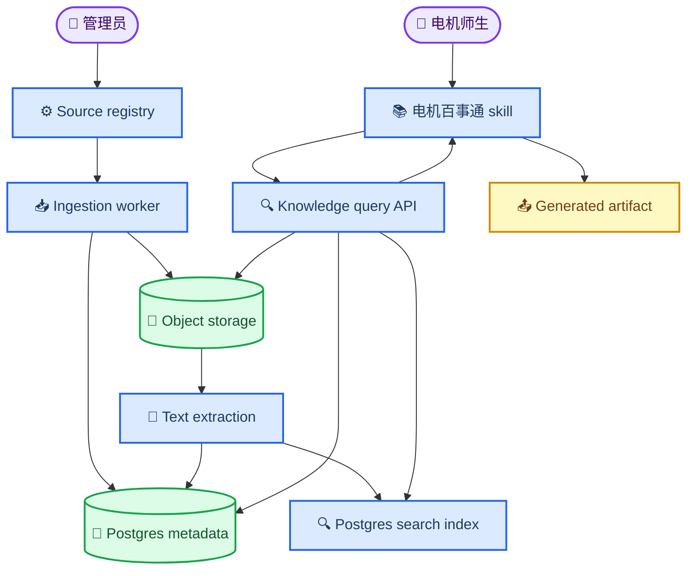
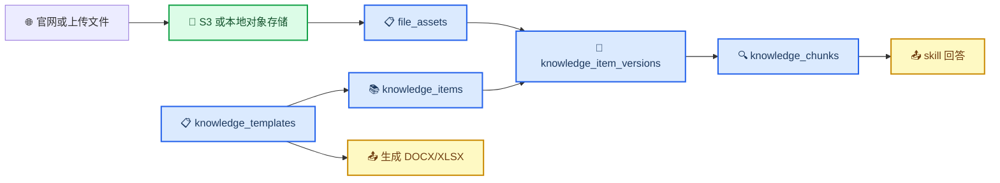
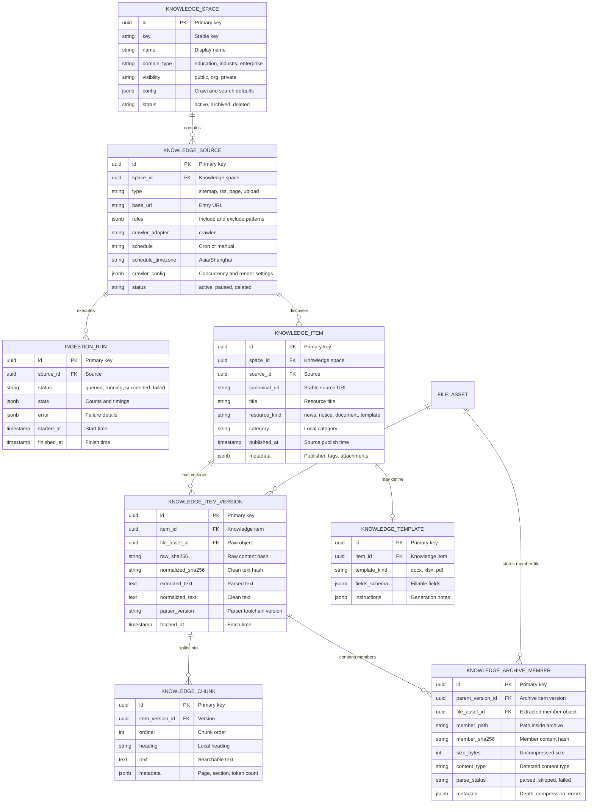
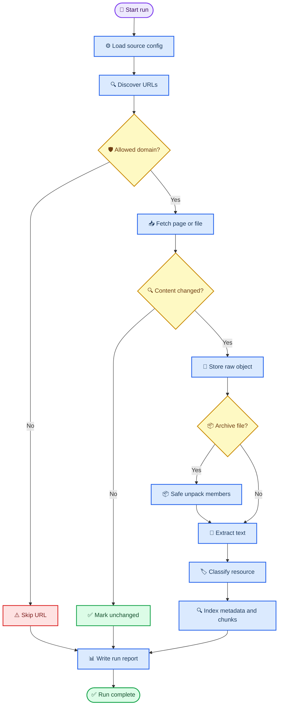
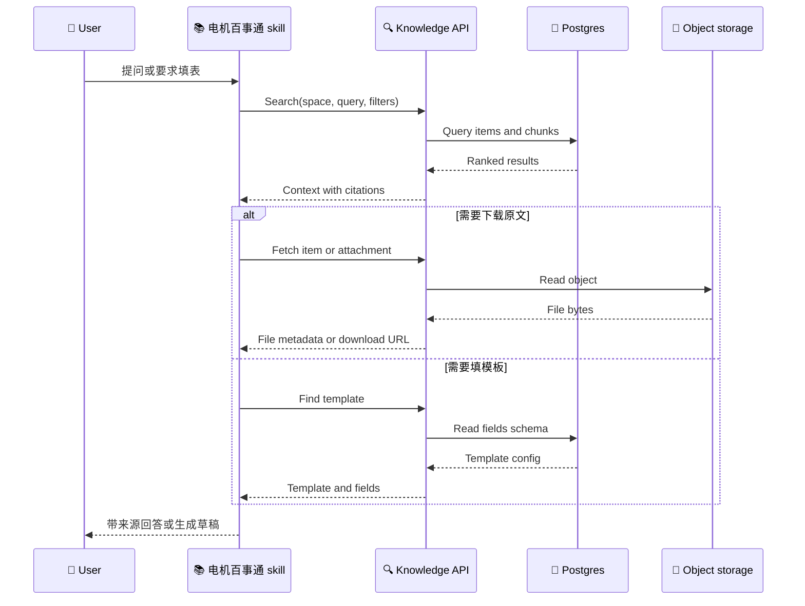

# 算子平台知识库 MVP 开发 Spec

_本文定义算子平台在 MVP 阶段建设平台级知识库模块的产品边界、技术架构、数据模型、接口契约和验收标准。首个实例是教育板块的“电机百事通” skill，面向所有公开用户查询上海电机学院新闻、通知、资料、模板和表格。_

---

## 📋 结论

MVP 阶段应建设一个**平台级 Knowledge Space 模板**，再把“电机百事通”作为第一个业务实例接入。知识库不是 skill 包内部文件夹，也不是 S3 目录；它是围绕对象存储、数据库元数据、正文抽取、分类索引、更新任务和查询 API 建立的可治理数据层。

MVP 不需要一开始引入独立向量数据库。需要的是 RAG-lite：

- 检索知识库中的网页、附件、模板和片段
- 把检索结果作为上下文交给模型回答
- 强制返回来源、发布时间和抓取时间
- 使用 Postgres 元数据过滤、模糊搜索和全文搜索先支撑业务
- 在内容规模和检索质量需要时再引入 `pgvector` 或独立向量库

## 🎯 目标

### 产品目标

- 在教育板块新增“电机百事通” skill 标签
- 支持电机师生和其他公开用户查询电机官网新闻、通知、资讯、政策、文档、模板和表格
- 支持根据模板生成简单的 DOCX/XLSX/PDF 草稿文件
- 支持所有回答追溯到来源 URL、附件和抓取版本
- 把数据采集、存储、清洗、分类、更新、查询做成可复制的全局模板

### 平台目标

- 新增通用 `knowledge_spaces` 模型，用同一套机制支持高校、行业、企业和其他领域
- 复用现有 Postgres、object storage、`file_assets` 和 agent artifact 能力
- 为 skill、workflow、agent 提供统一 Knowledge API
- 建立可观测、可重跑、可审计的 ingestion pipeline

## 🚫 非目标

MVP 不做以下能力：

- 不自动登录学校内部系统
- 不自动提交教务、财务、科研系统表单
- 不抓取需要登录、验证码、付费、内网权限或 robots 明确禁止访问的页面
- 不建设复杂知识图谱
- 不引入独立 Elasticsearch、Milvus、Qdrant 作为硬依赖
- 不做面向所有高校的通用管理后台
- 不把官网内容复制成公开镜像站

## 👥 用户和场景

| 用户 | MVP 场景 | 输出 |
|---|---|---|
| 本科生 | 查培养方案、课程通知、竞赛报名、办事流程 | 带来源的摘要和链接 |
| 研究生 | 查奖学金、培养流程、学位申请、实验室安全通知 | 带截止日期的清单 |
| 教师 | 查学院通知、项目申报、教学文档和表格 | 资料汇总和附件下载 |
| 校友/访客 | 查公开新闻、公告、政策和下载文件 | 公开资料检索结果 |
| 教务/行政 | 上传或校正模板、标记重要通知 | 知识条目和模板元数据 |
| 平台管理员 | 配置数据源、运行抓取、查看错误 | ingestion run 报告 |

## 🏗️ 系统架构

### 核心模块

| 模块 | 职责 | MVP 实现 |
|---|---|---|
| Knowledge Space | 定义知识域和可见性 | Postgres 表 |
| Source Registry | 管理官网栏目、RSS、sitemap、上传源 | Postgres 表 + Admin API |
| Ingestion Worker | 抓取、下载、去重、解析、分类 | 后台脚本或 worker |
| Object Storage | 保存原始 HTML 和所有公开可下载附件 | 复用 `@operator/storage` |
| Metadata Store | 保存条目、版本、分类、来源、模板字段 | Postgres |
| Search Index | 标题、正文、标签、日期过滤 | Postgres full text/trigram |
| Knowledge API | 给 skill 和前端检索 | Next.js route handlers |
| Skill Pack | 面向用户完成问答、填表、生成文件 | Mastra workspace skill |

### 成熟组件选型

MVP 不从零实现爬虫、队列、文档解析和压缩包解析。算子平台只实现业务编排、数据模型、权限、版本、去重、清洗和 API。

| 能力 | 选型 | 算子集成方式 |
|---|---|---|
| 官网爬虫 | Crawlee for JavaScript | 新增 `@operator/knowledge-ingestion`，默认用 `CheerioCrawler` 抓静态 HTML，遇到需要渲染的页面再降级到 `PlaywrightCrawler`[^5] |
| 深度链接队列 | Crawlee `RequestQueue` | 每个 `ingestion_run` 使用独立 queue id，支持从首页、栏目页、分页和详情页递归发现链接[^6] |
| 定期执行 | 现有 `@operator/queue` + BullMQ Job Schedulers | 每个 active source 根据 `schedule` upsert 一个 scheduler，定期 enqueue `knowledge-source-run` job[^7] |
| 文档解析 | Apache Tika + LibreOffice fallback | Tika 负责格式检测、元数据和正文抽取，Office 复杂文件解析失败时用 LibreOffice headless 转换后再抽取[^8][^9] |
| 压缩包解析 | Apache Tika package parser + 7-Zip CLI fallback | 先列出成员、大小和路径；安全通过后才解包成员，不执行任何文件[^8][^10] |

推荐新增运行入口：

| 位置 | 用途 |
|---|---|
| `packages/knowledge-ingestion` | 爬虫、下载、解析、清洗、去重、版本化核心库 |
| `apps/web/scripts/knowledge-workers.ts` | BullMQ worker，处理 `knowledge-source-run`、`knowledge-parse-file`、`knowledge-archive-expand` |
| `apps/web/app/api/operator/admin/knowledge/*` | source 配置、手动 run、run report 查询 |
| `apps/mastra/src/tools/knowledge.ts` | `operator.knowledge.search`、`operator.knowledge.getItem`、`operator.knowledge.fillTemplate` |

## 📦 知识库、对象存储和云盘关系

对象存储只负责保存二进制对象；知识库负责让这些对象可检索、可分类、可引用、可更新。

一个“研究生请假申请表.docx”的落库关系：

| 层 | 内容 |
|---|---|
| Object storage | 原始 DOCX 文件 |
| `file_assets` | bucket、object key、sha256、size、content type |
| `knowledge_items` | 标题、来源 URL、类型为 `template` 或 `form`、所属栏目 |
| `knowledge_item_versions` | 本次抓取版本、`file_asset_id`、抽取文本 |
| `knowledge_templates` | 可填写字段、字段类型、生成指令 |
| artifact | 用户填好后的新 DOCX/XLSX 草稿 |

### 云盘设计原则

云盘应是用户可管理的**文件索引和空间配额视图**。底层文件仍在对象存储中，云盘记录只保存用户空间、目录、文件名、可见性、引用的 `file_asset_id` 和删除状态。这样同一个对象可以被 artifact、knowledge item 和 drive object 共同引用，避免无意义复制。

当前代码里 `saveArtifactToDriveForSession` 的实现是 promoted copy：它会把 artifact 下载后重新写入 drive bucket，再创建新的 `file_assets` 和 `drive_objects`。这能工作，但不是长期最优形态。知识库 MVP 阶段应把云盘改为引用索引优先：

- 任务产物默认先作为 artifact 存在，不自动占用云盘额度
- 用户点击“保存到云盘”时，优先创建 `drive_objects -> file_assets` 引用
- 只有跨存储桶、权限隔离、生命周期策略不同或原对象即将过期时才复制 bytes
- 云盘额度按用户主动保存的 drive objects 计费
- 知识库公开原始文件不占用个人云盘额度
- 生成后的 DOCX/XLSX 草稿如果用户保存到云盘，则占用个人云盘额度
- 删除云盘文件默认只删除 `drive_objects` 索引，不立即删除底层对象；对象 GC 由后台根据引用计数和保留策略处理

MVP 不应再把 promoted copy 作为默认路径。为了兼容旧数据，可以保留 `linkType = "promoted_copy"` 的读取能力；新保存路径应新增 `linkType = "reference"`，默认只创建 drive object 索引。

### 开源网盘方案判断

成熟开源网盘系统可以作为参考或独立旁路服务，但不建议在 MVP 里直接替代算子内部云盘索引层。

| 方案 | 可借鉴能力 | 不建议直接替代的原因 |
|---|---|---|
| Nextcloud Files | 文件同步、共享、WebDAV、完整网盘产品形态[^1] | 是独立 PHP 应用和权限体系，难以直接绑定算子 artifact、knowledge item 和计费模型 |
| Seafile | 文件库、同步、分享、团队协作和对象存储后端[^2] | 文件对象模型自成体系，适合作为独立企业网盘，不适合作为轻量嵌入索引层 |
| Pydio Cells | datasource、workspace、对象存储挂载和数据库索引思路[^3] | 架构理念接近，但整套系统较重，引入后会产生双权限和双索引 |
| Filestash | S3、WebDAV、SFTP 等多后端文件管理 UI[^4] | 更像存储网关和文件浏览器，不负责算子任务产物、知识库来源、用户配额的一体化治理 |

MVP 建议保留自研云盘索引层：Postgres 维护 `drive_spaces`、`drive_objects`、`artifact_drive_links` 和 `file_assets` 关系，对象存储只保存 bytes。若后续需要成熟客户端能力，可以通过 WebDAV/S3 gateway 或旁路 Nextcloud/Seafile 提供企业网盘能力，但不要让它成为知识库和 artifact 的事实来源。

## 🧱 数据模型

### 最小枚举

| 字段 | MVP 值 |
|---|---|
| `resource_kind` | `news`, `notice`, `policy`, `document`, `template`, `form`, `download`, `archive`, `faq` |
| `source.type` | `sitemap`, `rss`, `page`, `attachment_page`, `manual_upload`, `full_site` |
| `visibility` | `public`, `organization`, `private` |
| `run.status` | `queued`, `running`, `succeeded`, `failed`, `cancelled` |
| `archive_member.parse_status` | `parsed`, `skipped`, `failed` |

## 🔄 Ingestion pipeline

### 爬虫配置和定期执行

`knowledge_sources` 必须保存可复现的爬虫配置，Admin UI 只是修改这些配置，不直接写死业务逻辑。

| 配置项 | MVP 值 |
|---|---|
| `crawler_adapter` | `crawlee` |
| `crawler_mode` | `http_first`，静态页面优先 |
| `render_fallback` | `playwright`，仅在页面链接必须渲染时启用 |
| `allow_hosts` | `www.sdju.edu.cn`, `*.sdju.edu.cn` |
| `deny_patterns` | 登录、SSO、验证码、退出、站点统计接口 |
| `same_host_concurrency` | `1-2` |
| `max_depth` | MVP 不硬编码深度，按 allowlist 和 URL 去重控制 |
| `schedule` | cron 字符串，默认每日低峰期增量抓取 |
| `full_rescan_schedule` | 每周或每月全量清单校验 |

定期执行由 BullMQ Job Scheduler 管理：

1. Admin 创建或更新 source 时，系统 upsert 对应 scheduler。
2. Scheduler 只投递轻量 job：`knowledge-source-run`，payload 包含 `source_id`、`run_type` 和触发原因。
3. Worker 创建 `ingestion_runs` 记录，再启动 Crawlee crawl。
4. URL 发现、文件下载、解包解析可以拆成子 job，但必须汇总到同一个 `ingestion_run`。
5. 手动触发、定时增量、全量 rescan 都走同一套队列和状态机。

### 抓取规则

- 电机首个 source 的起始域名是 `www.sdju.edu.cn`
- 域名白名单是 `www.sdju.edu.cn` 和 `*.sdju.edu.cn`
- 电机首个 source 的目标是公开全站抓取：官网首页、二级栏目、展开分页、详情页和所有公开可达附件
- 附件优先级高于新闻正文，所有下载型附件都必须保存原文件，包括但不限于 PDF、DOC、DOCX、XLS、XLSX、PPT、PPTX、ZIP、RAR、7Z、TXT、CSV、OFD、音视频文件
- 新闻、通知、公告是附件抓取之后的结构化信息层，不能只抓列表摘要
- 发现策略按 sitemap、栏目链接、分页链接、详情页链接、附件链接逐层展开
- 必须遵守来源域名白名单
- 必须读取并尊重 `robots.txt`，除非由管理员明确配置内部授权源
- 必须限速，MVP 默认同域并发 `1-2`
- 必须记录 `ETag`、`Last-Modified`、sha256 和抓取时间
- 必须支持 dry run，输出将新增、更新、跳过和失败的资源数

### 电机官网附件规模预估

2026-07-02 先做了一个轻量估算批次：从 `https://www.sdju.edu.cn/` 出发，限制最多 2500 个 HTML 页面、5000 个附件候选、180 秒运行时间；只做公开页面访问和附件 `HEAD`/range size 探测，不批量下载文件。

| 指标 | 结果 |
|---|---:|
| 已抓 HTML 页面 | 1155 |
| 停止时剩余页面队列 | 5376 |
| 已发现附件候选 | 207 |
| 已拿到大小的附件 | 168 |
| 未返回大小的附件 | 39 |
| 已知附件总大小 | 121.45 MB |
| 按已知均值外推当前样本 | 149.64 MB |

| 扩展名 | 数量 | 已知大小 |
|---|---:|---:|
| `.doc` | 83 | 0.66 MB |
| `.docx` | 68 | 0.85 MB |
| `.pdf` | 34 | 111.64 MB |
| `.zip` | 10 | 8.13 MB |
| `.xlsx` | 6 | 0.07 MB |
| `.xls` | 5 | 0.04 MB |
| `.rar` | 1 | 0.06 MB |

这个批次还不是全量，但已经说明附件库很可能在几个 GB 以内。MVP 策略应先生成完整附件清单，再按 sha256 去重后全量下载；如果全量清单超过预设预算，再启用冷存储、CDN 限速或分批抓取。

### 解析规则

| 文件类型 | MVP 处理 |
|---|---|
| HTML | 提取标题、正文、发布时间、栏目、附件链接 |
| PDF | 重点抓取；保存原文件，尽量抽取文本；失败时标记 `text_extraction_failed` |
| DOC/DOCX | 重点抓取；保存原文件，抽取正文；模板候选直接入库并标记 `template_candidate` |
| XLS/XLSX | 重点抓取；保存原文件，抽取 sheet 名和可读单元格；模板候选直接入库并标记 `template_candidate` |
| PPT/PPTX | 保存原文件；PPTX 尽量抽取文本；PPT 解析失败时保留原文件 |
| ZIP/RAR/7Z | 保存原包并默认安全解包；解出的资料文件作为可检索资源入库 |
| 其他附件 | 保存原文件、扩展名、Content-Type、大小、sha256 和来源页面 |
| 图片 | 保存公开资料附件图片；站点模板图片不计入资料库；MVP 不做 OCR |

### 解包、去重、清洗和版本管理

压缩包不是简单保存后结束。MVP 需要把压缩包作为一个父资源，同时把安全解包后的成员作为可检索资源。用户检索和下载时优先看到解出的文件；原始压缩包默认作为来源证据和可复现快照保留，不作为主要搜索结果展示。

| 阶段 | MVP 规则 |
|---|---|
| 原包保存 | ZIP/RAR/7Z/TAR/GZ 等原始压缩包必须完整保存为 `file_assets`，创建父 `knowledge_item` 和 `knowledge_item_version`；原包默认标记为 `archive_parent` |
| 安全检查 | 解包前检查压缩包大小、成员数、嵌套深度、解压后总大小和压缩比，超过阈值则只保存原包并标记 `archive_expand_skipped` |
| 成员清单 | 无论是否全文解析，都记录 `knowledge_archive_members.member_path`、大小、Content-Type、成员 sha256 和解析状态 |
| 成员入库 | 成员是 PDF、Office、文本、图片或其他资料附件时，创建或复用成员 `file_assets`，生成独立 `knowledge_item` 或 `knowledge_item_version`，并挂到父 archive version |
| 来源追溯 | 每个解出文件必须记录原始压缩包 URL、父 archive item id、父 archive version id、父 `file_asset_id` 和 `member_path` |
| 成员去重 | 成员 sha256 如果已经存在于任意 `file_assets`，不重复写对象存储，只新增引用关系和来源路径 |
| 跨来源去重 | 普通附件、压缩包成员、管理员上传文件、用户保存文件共享同一套 sha256 去重逻辑 |
| 清洗 | HTML 去导航、页脚、脚本和重复空白；Office/PDF 去控制字符、分页噪声和重复页眉页脚；表格保留 sheet 名、行列坐标和可读文本 |
| 版本判断 | `raw_sha256` 不变则标记 unchanged；`raw_sha256` 变化则创建新 `knowledge_item_versions` |
| 归一化判断 | `normalized_sha256` 不变但 `raw_sha256` 变化时，保留新版本但不重建 chunk；用于处理只改文件元数据的情况 |
| parser 版本 | `parser_version` 变化时允许重跑解析并更新 `normalized_text`、`normalized_sha256` 和 chunk |
| 原包清理 | MVP 不默认删除原包；可配置生命周期策略，将已成功解包且已去重的原包转冷存储，或在保留期后仅删除对象 bytes、保留元数据和 sha256 |
| 删除和失效 | 来源页面移除附件时不立即删除对象，标记 item stale；对象清理由引用计数和生命周期策略处理 |

解包必须在受限临时目录中执行，禁止执行宏、脚本、可执行文件和压缩包内路径穿越。MVP 不需要把压缩包重新打散成用户可见的目录树，但搜索结果必须能显示“该文件来自哪个原始压缩包 URL、哪个压缩包版本、压缩包内哪个路径”。

## 🔍 检索和 RAG-lite

MVP 使用 RAG-lite，而不是完整向量 RAG。

### 查询流程

### MVP 排序策略

| 信号 | 用途 |
|---|---|
| 标题匹配 | 精确资料名、表格名、通知名 |
| 正文匹配 | 常规问答 |
| 分类过滤 | 新闻、通知、模板、政策 |
| 时间过滤 | 最近通知、截止日期相关问题 |
| 来源权重 | 官网栏目优先于转载页面 |
| 人工精选 | 常用模板、重要流程置顶 |

### 何时升级到向量检索

满足以下任一条件再加 `pgvector` 或独立向量库：

- 用户口语化问题经常搜不到
- 文档量超过 Postgres 全文搜索的舒适范围
- 需要跨文档语义归纳
- 需要多语言或同义词检索
- 模板和流程名称差异过大，关键词匹配不稳定

## 🧩 电机百事通 skill

### 标签配置

| 字段 | 值 |
|---|---|
| scope id | `dianji-assistant` |
| 分组 | 教育 |
| display name | 电机百事通 |
| output format | `knowledge_answer`, `docx`, `xlsx` |
| 依赖 | `knowledge_space=dianji` |

### 能力边界

| 能力 | MVP 行为 |
|---|---|
| 查新闻 | 返回最近新闻列表、摘要和来源 |
| 查通知 | 支持按时间、栏目、关键词查通知 |
| 查资料 | 返回政策、流程、培养方案、附件 |
| 找模板 | 返回模板文件、适用场景、字段说明 |
| 填表格 | 生成草稿，不自动提交 |
| 生成文档 | 基于模板生成 DOCX/XLSX artifact |

### Skill 执行要求

- 回答必须引用 `knowledge_item.id`、来源 URL 和抓取时间
- 不能编造官网没有的政策、日期和表格字段
- 不确定时必须说明“知识库未找到明确依据”
- 填表时必须向用户确认缺失字段
- 生成文件必须保留原模板来源和版本信息

## 🔌 API 契约

### User-facing API

| Method | Path | 用途 |
|---|---|---|
| `GET` | `/api/operator/knowledge/search` | 搜索知识库 |
| `GET` | `/api/operator/knowledge/items/:id` | 查看知识条目 |
| `GET` | `/api/operator/knowledge/items/:id/download` | 下载原始附件 |
| `GET` | `/api/operator/knowledge/templates` | 搜索可填模板 |
| `POST` | `/api/operator/knowledge/templates/:id/fill` | 生成填好的草稿文件 |

### Admin API

| Method | Path | 用途 |
|---|---|---|
| `POST` | `/api/operator/admin/knowledge/spaces` | 创建 knowledge space |
| `POST` | `/api/operator/admin/knowledge/sources` | 创建数据源 |
| `POST` | `/api/operator/admin/knowledge/sources/:id/run` | 手动触发抓取 |
| `GET` | `/api/operator/admin/knowledge/runs/:id` | 查看抓取结果 |
| `PATCH` | `/api/operator/admin/knowledge/items/:id` | 人工修正分类和标签 |

### Agent tool

| Tool | 输入 | 输出 |
|---|---|---|
| `operator.knowledge.search` | `space`, `query`, `filters`, `limit` | ranked items and chunks |
| `operator.knowledge.fetch` | `item_id`, `include_file` | item detail and source file |
| `operator.knowledge.find_template` | `space`, `query`, `output_format` | template candidates |
| `operator.knowledge.fill_template` | `template_id`, `fields` | generated artifact |

## 🔐 权限和合规

MVP 默认将电机官网公开内容作为 `public` 知识，面向所有访问者开放。人工上传资料仍需要按来源区分权限：如果上传的是公开官网资料，可以标为 `public`；如果上传的是非公开内部资料，必须进入组织或私有可见性。

| 资源 | 默认权限 |
|---|---|
| 官网公开网页 | `public` |
| 官网公开附件 | `public` |
| 管理员上传的公开模板 | `public` |
| 管理员上传的内部模板 | `organization` |
| 用户生成草稿 | 用户私有 artifact 或 drive object |
| 抓取日志 | 管理员可见 |

电机官网公开数据不需要人工审核即可入库。管理员修正只用于提高分类、标签和模板字段质量，不作为发布前 gate。

必须记录以下审计字段：

- 数据来源 URL
- 抓取时间
- 原始文件 sha256
- 解析器版本
- 分类来源，区分规则分类、模型分类和人工修正
- 模板填充生成者和生成时间

## 📊 可观测性

每次 ingestion run 需要输出结构化报告：

| 指标 | 说明 |
|---|---|
| `discovered_urls` | 发现 URL 数 |
| `fetched_items` | 成功抓取数 |
| `unchanged_items` | hash 未变化数 |
| `new_items` | 新增条目数 |
| `updated_items` | 更新条目数 |
| `failed_items` | 抓取或解析失败数 |
| `stored_bytes` | 新增对象存储体积 |
| `parse_failures_by_type` | 按文件类型统计解析失败 |
| `archive_members_found` | 压缩包成员数 |
| `deduped_file_assets` | 因 sha256 命中而复用的文件数 |
| `scheduled_runs` | 定时触发的 run 数 |

## 🧪 验收标准

### 数据验收

- 至少配置 1 个电机官网公开全站 source，覆盖首页、二级栏目、分页、详情页和附件链接
- 至少抓取 100 条公开网页或附件资源，其中附件资源必须单独统计
- 至少识别 10 个模板或表格候选
- 每个知识条目都有来源 URL、标题、类型、抓取时间和版本 hash
- 重复抓取不会重复创建同一资源
- 至少处理 1 个 ZIP/RAR/7Z 样例，生成成员清单并对成员 sha256 去重
- 同一个文件作为普通附件和压缩包成员重复出现时，只保存一份 `file_assets`

### 检索验收

- 能查到最近通知
- 能按“奖学金”“培养方案”“请假”“报销”等关键词找到相关资源
- 搜索结果包含标题、摘要、类型、发布时间、来源 URL
- 回答中至少引用 1 个来源
- 未命中时返回明确的未找到结果，不编造

### 填表验收

- 能找到一个 DOCX 或 XLSX 模板
- 能展示模板字段 schema
- 能根据用户字段生成草稿 artifact
- 生成文件 metadata 包含模板 item id 和 version id

### 运维验收

- Admin 可手动触发一次 source run
- active source 可通过 BullMQ scheduler 定期触发增量 run
- 失败 run 可查看错误列表
- 线上部署不依赖向量库
- object storage 可切换本地或 S3-compatible adapter

## 🧭 实施计划

### Milestone 1: 数据模型和对象存储接入

- 新增 knowledge tables 和 migration
- 新增 archive member 和 normalized hash 字段
- 复用 `file_assets` 和 object storage adapter
- 实现手工上传或 fixture ingestion
- 提供最小 search API

### Milestone 2: 官网抓取和解析

- 实现 source registry
- 接入 Crawlee，支持 HTML 列表页和详情页抓取
- 接入 BullMQ Job Scheduler，支持 source 定期执行
- 支持所有下载型附件原文件保存，重点解析 PDF、Office 文档和压缩包元数据
- 支持附件优先的全站公开链接展开
- 支持压缩包安全解包、成员清单、成员去重和解析状态
- 写入 ingestion run report

### Milestone 3: 电机百事通 skill

- 注册教育板块 scope
- 增加 `operator.knowledge.*` agent tools
- 实现新闻、通知、资料、模板查询
- 回答强制带来源

### Milestone 4: 模板填充

- 建立模板候选和人工修正机制
- 支持 DOCX/XLSX 简单字段替换
- 生成 artifact，并支持保存到云盘；云盘保存优先引用已有 `file_assets`

### Milestone 5: 管理和质量提升

- 增加 Admin API
- 增加分类规则配置
- 增加抓取健康面板
- 增加 scheduler 健康状态和最近运行历史
- 评估是否需要 `pgvector`

## ⚠️ 风险和缓解

| 风险 | 影响 | 缓解 |
|---|---|---|
| 官网结构变化 | 抓取失败 | source rule 版本化，run report 报错 |
| 附件解析失败 | 搜索不可用 | 保留原文件，标记解析失败，人工补摘要 |
| 模板字段不稳定 | 填表错误 | MVP 只生成草稿，要求用户确认 |
| 内容过期 | 回答误导 | 显示发布时间、抓取时间和 stale 标记 |
| 误爬非公开内容 | 合规风险 | `*.sdju.edu.cn` allowlist、robots、无登录抓取 |
| 搜索质量不足 | 用户体验差 | 先做人工精选和同义词，后续加向量检索 |
| 全站附件体积过大 | 存储成本上升 | 附件全抓但按 sha256 去重；设置对象生命周期和冷存储策略 |

## ✅ 已确认 MVP 决策

- 电机首个 source 按 `www.sdju.edu.cn` 和 `*.sdju.edu.cn` 公开全站抓取，不只抓固定栏目
- 抓取范围包括首页、二级栏目、分页、详情页和所有公开可达附件
- 所有下载型附件都保存原文件，PDF、DOC、DOCX、XLS、XLSX、PPT、PPTX、ZIP、RAR 等是第一批重点类型
- 新闻、通知、公告作为结构化信息同步入库
- 电机百事通知识查询面向所有人开放
- 公开数据不需要人工审核即可发布
- 云盘 MVP 必须改成引用索引优先；对象存储是底层文件事实来源
- 爬虫工具选择 Crawlee，定期执行接入现有 BullMQ 队列体系
- 压缩包需要安全解包，解出的文件作为一等资源入库；原包保留为来源快照，成员与普通附件统一 sha256 去重

## ❓ 后续待确认问题

- 正式全量清单跑完后，确认附件总量是否仍在几个 GB 内
- 是否设置单文件下载大小上限；若不设，上限只受对象存储和任务超时约束
- 是否需要为公开资料设置 CDN 或下载限速
- 云盘扩容和充值的产品规则、价格、免费额度和过期文件清理策略

## ✅ MVP 定义

MVP 完成的标准是：任何用户都可以在教育板块选择“电机百事通”，查询电机官网公开资讯、网页和可下载文件，获得带来源的回答，并能基于公开常用模板生成可下载的 DOCX/XLSX 草稿。平台侧沉淀出可复用的 Knowledge Space、Source、Ingestion、Search、Template Fill 和 Drive Reference 基础能力，后续可复制到其他高校、行业和领域。

## 📚 参考资料

[^1]: Nextcloud. "Nextcloud Files." https://nextcloud.com/files/

[^2]: Seafile. "Introduction - Seafile Admin Manual." https://manual.seafile.com/latest/

[^3]: Pydio. "Datasources overview." https://docs.pydio.com/latest/admin-guide/connect-your-storage/datasources-overview/

[^4]: Filestash. "File Management System for Web." https://github.com/mickael-kerjean/filestash

[^5]: Crawlee. "Quick Start." https://crawlee.dev/js/docs/quick-start

[^6]: Crawlee. "RequestQueue." https://crawlee.dev/js/api/core/class/RequestQueue

[^7]: BullMQ. "Job Schedulers." https://docs.bullmq.io/guide/job-schedulers

[^8]: Apache Tika. "Supported Document Formats." https://tika.apache.org/2.9.2/formats.html

[^9]: LibreOffice Help. "Starting LibreOffice Software With Parameters." https://help.libreoffice.org/latest/he/text/shared/guide/start_parameters.html

[^10]: 7-Zip. "Download." https://www.7-zip.org/download.html
