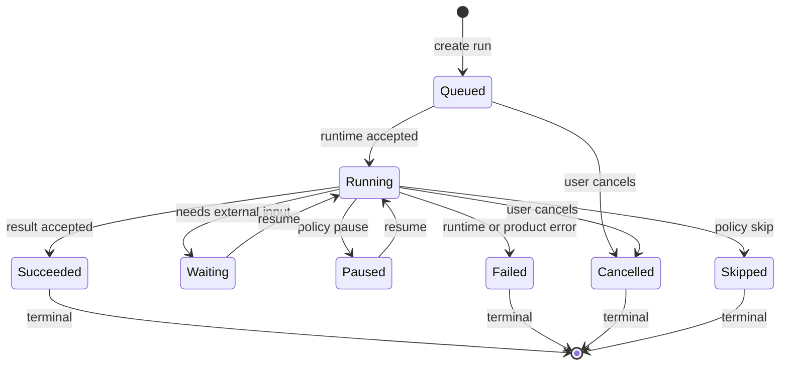
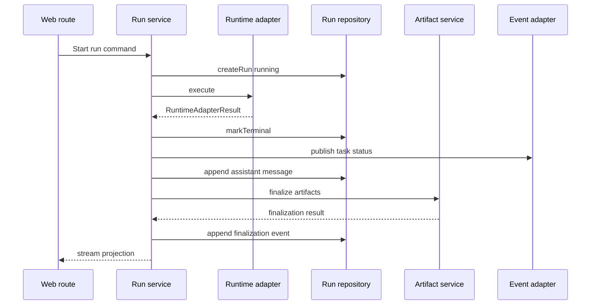

# Operator 薄产品契约重构 Spec

_本文是 `docs/OPERATOR_PLATFORM_REFACTOR_PLAN.md` 的详细实施规范。目标是在 MVP 阶段用最小自研契约统一任务生命周期、消息边界、产物交付和框架适配。_

---

## 范围

本文定义 `@operator/contracts` 的接口边界、状态模型、DTO、adapter 协议、迁移步骤和验收标准。

本文不定义：

- Mastra agent/workflow/tool 的内部实现
- ACP client 的协议细节
- BullMQ worker 的部署拓扑
- Drizzle schema 的完整迁移 SQL
- React 组件结构
- S3 SDK 调用细节

这些能力由现有成熟框架或现有 adapter 目录承载。

## 标准工具优先清单

薄产品契约不等于所有内部机制都自写。以下能力必须优先使用成熟工具或行业标准，Operator 只保留产品语义和 adapter mapper。

| 契约内能力 | 标准工具或标准 | 规范要求 |
|---|---|---|
| 状态机 transition | XState | `RunStatus` 名称由 Operator 定义，但 transition 表达优先用 XState statechart；如果第一版不安装 XState，也必须保持 XState-compatible 配置和测试 |
| DTO/schema validation | Zod | 所有 contracts DTO 必须有 Zod schema；TypeScript type 从 schema 推导或与 schema 同步测试 |
| product event envelope | CloudEvents | `ProductEvent` 使用 CloudEvents-compatible envelope，Operator 业务内容放在 `data` |
| REST API contract | OpenAPI | `/api/operator/*` 对外 DTO 必须能由 schema 生成 OpenAPI，禁止手写一套不一致接口文档 |
| event/SSE/job contract | AsyncAPI | AG-UI 投影、SSE、BullMQ job payload、webhook 事件必须能用 AsyncAPI 描述 |
| background job | BullMQ/Redis | reconciler、artifact retry、scope sync、drive maintenance 使用 BullMQ；测试可用 fake queue，生产不可静默 disabled |
| durable long workflow | Temporal 或 Inngest | 不进入 MVP 第一批；当出现跨天任务、人审暂停、补偿事务、复杂重试时，必须做 ADR 评估，禁止自研 durable workflow |
| frontend stream/thread | AG-UI、assistant-ui、Vercel AI SDK | 前端运行时、消息流、工具过程展示使用标准库；Operator 只提供 `TaskSnapshot` 和 event projection |
| observability | OpenTelemetry、Mastra tracing、Langfuse | MVP 第一批接入 OpenTelemetry SDK 和 Mastra tracing adapter；Langfuse 平台本体外挂，使用云端或自部署实例 |
| authentication | OIDC/JWT/JWS、Auth.js、`jose`、opaque DB session | 外部身份用 OIDC/JWT；自有 session 优先 opaque DB token；需要签名 token 时用标准 JWS/JWT |
| authorization | 简单产品权限、Casbin、OpenFGA | MVP 保持简单 owner/admin/member 产品权限；超过简单权限后先评估 Casbin，复杂多租户关系授权再评估 OpenFGA |

禁止把这些工具能力复制到 `@operator/contracts`。contracts 可以依赖轻量标准库，例如 `zod` 和经评估后的 XState/CloudEvents helper，但不能重新实现这些库。

## MVP 选型边界

本 spec 中出现多个成熟工具时，必须按以下 MVP 取舍执行，不得理解为第一版全部引入。

| 取舍类别 | 工具 | MVP 要求 |
|---|---|---|
| 仓库内直接依赖 | Zod、CloudEvents-compatible event helper、OpenAPI/AsyncAPI 生成工具、AG-UI SDK、assistant-ui、Vercel AI SDK、`jose`、Auth.js 或现有认证 adapter、OpenTelemetry SDK | 可以进入 `package.json`，通过 contracts、adapter、测试和生成脚本接入 |
| 应用依赖 + 外挂基础设施 | BullMQ + Redis | BullMQ job producer/worker 代码进入仓库；Redis 不内嵌到应用，使用本地 Docker、托管 Redis 或独立 Redis 服务 |
| 可嵌入但延迟到明确需要 | XState、Casbin | lifecycle 第一版可先使用 XState-compatible statechart 和测试；权限超过简单 owner/admin/member 后再接 Casbin |
| 暂缓的大型平台 | Temporal、Inngest、OpenFGA、Langfuse 平台本体 | 不进入 MVP 第一批；只保留 adapter 边界和 ADR 触发条件 |

MVP 第一批必须完成：

- `@operator/contracts` 的 Zod schema、CloudEvents-compatible `ProductEvent`、OpenAPI/AsyncAPI 生成入口
- BullMQ/Redis 的生产队列接入，替代 route 内轮询和 `DisabledJobQueue` 的生产行为
- AG-UI、assistant-ui、Vercel AI SDK 的前端事件和线程投影边界
- `jose`/Auth.js 或现有认证 adapter 的标准 token/session 边界
- OpenTelemetry SDK 和 Mastra tracing adapter 的最小观测接入

MVP 第一批不得做：

- 同时引入 Temporal/Inngest 来替代 BullMQ
- 把 OpenFGA 作为默认权限服务
- 在主仓库中自部署或嵌入 Langfuse 平台本体
- 自研 durable workflow、细粒度授权引擎、trace backend、stream protocol 或 JWT/JWS 格式

## 自研替代层清理清单

本节是强制清理清单。凡是当前代码用自研实现替代成熟框架能力的部分，重构时必须删除或收缩为薄 adapter。薄 adapter 只能做配置映射、类型转换、错误码标准化和产品事件投影，不能重新实现框架已经提供的协议、调度、持久化、观测或前端运行时。

| 当前自研或重复实现 | 标准框架能力 | 处理要求 | 验收标准 |
|---|---|---|---|
| `apps/mastra/src/agents/acp-client.ts` 自定义 ACP client | `@mastra/acp`、Agent Client Protocol SDK | 目标是删除自定义 client。只保留 Mastra ACP agent 配置 mapper 和 `RuntimeAdapterResult` mapper | 主 runtime 通过标准 `@mastra/acp` agent 注册和调用；产品层不 import ACP SDK；缺失能力必须用 ADR 记录，不得继续扩散自定义 client |
| endpoint-only / HTTP 私有 proxy runtime，例如历史 `codex-exec-proxy` | ACP command-based external agent runtime | 保持删除，不允许恢复。Codex、Claude Code、OpenHands、DeepSeek-backed runtime 统一通过 ACP command 暴露 | 配置中出现 endpoint-only runtime 时启动失败并提示改用 ACP；测试覆盖 legacy proxy config rejection |
| `runOperatorAgent` 内部自建 fallback 调度语义 | Mastra runtime 注册能力 + ACP agent 配置 + Operator 薄 attempts 契约 | fallback 顺序可作为产品配置保留，但执行和 agent 生命周期交给 Mastra/ACP。Operator 只记录 attempts | fallback attempts 是契约 DTO；不再自建 agent lifecycle 状态机 |
| `apps/mastra/src/runner.ts` 自定义 workflow runner 包装 Mastra workflow 结果 | Mastra workflows、workflow run/snapshot/result | 删除自定义 mini workflow engine 倾向。保留极薄 result mapper，把 Mastra workflow result 映射为 `RuntimeAdapterResult` | workflow 执行、状态、失败由 Mastra workflow API 表达；Operator 不维护独立 workflow step engine |
| `apps/web/lib/operator-task-events.ts` 内存 listeners 和自定义 `operator.task_status` 协议 | AG-UI event protocol、Vercel AI SDK stream、assistant-ui runtime；跨请求状态来自 DB/BullMQ | 删除产品级自定义 status 协议。实时展示统一投影为 AG-UI；刷新和跨请求恢复统一读取 `TaskSnapshot` | 前端不再订阅 `operator-task-status` 自定义事件；terminal 判定来自 `TaskSnapshot.latestRun.status` 或 AG-UI terminal event |
| `/api/operator/task-events` 中用 `setInterval` 轮询 persisted status | BullMQ/Redis job events、DB query、AG-UI stream | 删除轮询式状态修复。后台 reconciler 用 BullMQ；前端刷新用 task-detail query | 不再用每秒轮询来弥补生命周期缺口；stale run 修复由 reconciler 完成 |
| route 内 `setInterval` 周期性制造进度文本 | AG-UI activity/progress event + runtime trace | 只允许 event adapter 生成标准 activity snapshot。禁止在 route 中长期维护产品进度状态 | route 不直接定义 progress 状态机；progress event 可由 runtime trace 或 service event 投影 |
| React 组件里的自定义运行中恢复、DOM query recovery、历史 assistant 消息完成推断 | assistant-ui thread runtime + Operator `TaskSnapshot` | 删除前端产品状态推断。组件只展示 `TaskSnapshot` 和 AG-UI 投影 | 不再用“是否已有 assistant 消息”判断当前 run 完成；多轮任务以 `runId/turnId` 为边界 |
| `DisabledJobQueue` 作为生产行为 | BullMQ/Redis | `DisabledJobQueue` 只允许测试和本地显式开发模式。生产必须配置 Redis 并使用 BullMQ | 生产配置缺失 `REDIS_URL` 时后台任务能力报错或显示不可用，不静默假成功 |
| 自研对象存储下载/签名协议替代 S3 | S3-compatible storage、AWS SDK presigned URL | 正式生产下载、预览、保存使用 S3-compatible adapter。Local FS 只作为开发和单机内测 adapter | 正式生产环境 `OPERATOR_DEPLOYMENT_STAGE=production` 且 `OPERATOR_STORAGE_PROVIDER=s3`；下载链接来自 storage adapter，不直接暴露本地路径 |
| artifact 扫描目录猜测用户产物 | skill/workflow artifact manifest + `ArtifactContract` | 目录扫描只允许 legacy compatibility。新 skill/workflow 必须声明 artifact manifest 或输出契约 | 新任务产物来自 manifest/contract；系统运行元数据不会被猜测成用户产物 |
| 自研 LLM/agent trace 存储替代 observability | Mastra tracing、OpenTelemetry、Langfuse external backend 或同类系统 | `runtime.trace` 只用于用户可见过程和审计摘要，不建设自研观测平台，也不在主仓库嵌入 Langfuse 平台本体 | LLM 调用、latency、token、provider trace 接入标准 observability adapter；ProductEvent 不替代 tracing backend |
| HMAC payload session cookie 作为长期身份标准 | OIDC/JWT/JWS 标准库、opaque DB session cookie、`cookie` 库 | 外部身份用 OIDC/JWT。自有登录优先使用 opaque session token + DB session；如需签名 token，用 `jose` JWS/JWT，不自研格式 | cookie 仅承载 opaque token 或标准 JWS/JWT；身份校验逻辑集中在 identity adapter |
| 自定义 scope/skill 逻辑复制 GitHub skill 内容 | Mastra workspace skill source、MCP/Composio/Smithery 等工具生态 | Operator 只定义 scope 产品目录和 output contract，不复制 skill 执行逻辑 | 新 scope 绑定到标准 skill/workflow/tool source；Web 不硬编码 skill 内部规则 |

删除优先级：

1. 先删除会直接造成用户可见不一致的自研替代：task status 协议、前端完成推断、route 内 lifecycle/progress 状态。
2. 再删除 runtime 协议重复实现：自定义 ACP client、私有 proxy、fallback 生命周期。
3. 再删除正式生产基础设施替代：禁用队列、local storage 正式生产路径、自研 trace 存储。
4. 最后清理兼容层：legacy artifact 扫描、legacy message id、旧 task-detail alias。

允许保留的 Operator 自研代码只有三类：

- 产品契约：`RunStatus`、`TaskSnapshot`、`MessageContract`、`ArtifactContract`、`ScopeContract`、`OperatorError`
- adapter mapper：框架类型到产品契约的单向映射
- 产品策略：权限、计费、审计、scope output contract、用户可见任务体验

## 包边界

新增包：

```text
packages/operator-contracts/
  package.json
  tsconfig.json
  src/index.ts
  src/run-status.ts
  src/run-identity.ts
  src/run-events.ts
  src/errors.ts
  src/messages.ts
  src/artifacts.ts
  src/scopes.ts
  src/task-snapshot.ts
  src/runtime-adapter.ts
  src/persistence-adapter.ts
  src/event-adapter.ts
  src/validation.ts
  tests/
```

### 允许依赖

契约包允许依赖：

- TypeScript
- `zod`，作为 DTO schema 的默认运行时校验库
- 经 ADR 确认后的 XState，用于 lifecycle statechart
- 经 ADR 确认后的 CloudEvents helper，用于 event envelope 校验
- 本包内部模块

### 禁止依赖

契约包禁止依赖：

- `@operator/mastra-app`
- `@operator/db`
- `@operator/storage`
- `@ag-ui/core`
- `next`
- `react`
- `drizzle-orm`
- `node:fs`
- `node:path`
- 环境变量

## 生命周期状态

Operator 产品层统一状态：

```ts
export const RUN_STATUSES = [
  "queued",
  "running",
  "paused",
  "waiting",
  "skipped",
  "succeeded",
  "failed",
  "cancelled"
] as const;

export type RunStatus = (typeof RUN_STATUSES)[number];
export type TerminalRunStatus = "succeeded" | "failed" | "cancelled" | "skipped";
export type ActiveRunStatus = "queued" | "running" | "paused" | "waiting";
```

状态机：



必须提供纯函数：

```ts
export function isRunStatus(value: unknown): value is RunStatus;
export function isTerminalRunStatus(status: RunStatus): status is TerminalRunStatus;
export function isActiveRunStatus(status: RunStatus): status is ActiveRunStatus;
export function canTransitionRunStatus(from: RunStatus, to: RunStatus): boolean;
export function assertRunTransition(from: RunStatus, to: RunStatus): void;
```

规则：

- terminal 状态幂等写入同一 terminal 状态时允许
- terminal 状态不得回到 active 状态
- `failed` 必须携带 `OperatorError`
- `succeeded` 必须携带可序列化 output 或明确空 output 原因
- `cancelled` 必须携带 actor 或 source
- `skipped` 只用于策略跳过，不用于 runtime failure

## 标识契约

### `RunIdentity`

```ts
export type RunIdentity = {
  taskId: string;
  conversationId: string;
  runId: string;
  turnId: string;
  userMessageId: string;
  scopeId?: string;
};
```

语义：

- `taskId` 是用户侧任务入口
- `conversationId` 是多轮消息容器
- `runId` 是一次 agent/workflow 执行
- `turnId` 是一次用户提交与后续 assistant 响应的边界
- `userMessageId` 是本轮用户消息 ID
- `scopeId` 是用户选择的 Operator 产品 scope

要求：

- 多轮完成判定必须以 `turnId` 或 `runId` 为边界
- 禁止用“历史里是否存在 assistant 消息”判断当前 run 完成
- API、DB、前端恢复都必须保留 `runId`

### `MessageContract`

```ts
export type OperatorMessageRole = "user" | "assistant" | "system" | "tool";

export type MessageContract = {
  id: string;
  conversationId: string;
  taskId: string;
  runId?: string;
  turnId?: string;
  role: OperatorMessageRole;
  content: string;
  createdAt: string;
  metadata: Record<string, unknown>;
};
```

规则：

- 用户消息必须有 `turnId`
- assistant final message 必须关联 `runId` 和 `turnId`
- tool/system message 可无 `turnId`，但必须可追溯到 conversation
- legacy message 缺失 ID 时只能在 adapter 中生成稳定兼容 ID，不得扩散到契约层

## 事件契约

### `ProductEvent`

```ts
export type ProductEventKind =
  | "run.created"
  | "run.started"
  | "run.progress"
  | "run.waiting"
  | "run.paused"
  | "run.succeeded"
  | "run.failed"
  | "run.cancelled"
  | "run.skipped"
  | "runtime.trace"
  | "artifact.finalization_started"
  | "artifact.finalization_succeeded"
  | "artifact.finalization_failed"
  | "reconciler.repaired"
  | "reconciler.skipped";

export type ProductEvent = {
  id?: string;
  specversion?: "1.0";
  source?: string;
  subject?: string;
  runId: string;
  taskId: string;
  seq?: number;
  kind: ProductEventKind;
  type?: string;
  time?: string;
  timestamp: string;
  payload: Record<string, unknown>;
  data?: Record<string, unknown>;
};
```

规则：

- 第一版兼容现有 `kind/timestamp/payload`，但新 adapter 必须同时写入 CloudEvents-compatible `specversion/source/type/time/data`
- `type` 使用 `operator.<kind>` 形式，例如 `operator.run.succeeded`
- `source` 使用稳定服务标识，例如 `/operator/web`、`/operator/mastra`、`/operator/reconciler`
- `subject` 推荐使用 `tasks/{taskId}/runs/{runId}`
- `data` 是标准业务 payload，`payload` 只作为过渡期 alias
- DB adapter 负责分配 `seq`
- 同一 run 内 `seq` 必须递增
- terminal event 必须与 run terminal status 同步存在
- AG-UI event 是 `ProductEvent` 的前端投影，不是产品事实源
- runtime trace 只能作为 event payload，不能改变 run status

## 错误契约

```ts
export type OperatorErrorCode =
  | "OPERATOR_RUNTIME_NOT_CONFIGURED"
  | "OPERATOR_ACP_CONNECTION_CLOSED"
  | "OPERATOR_RUNTIME_TIMEOUT"
  | "OPERATOR_RUNTIME_EMPTY_RESPONSE"
  | "OPERATOR_RUNTIME_PROTOCOL_ERROR"
  | "OPERATOR_RUNTIME_CANCELLED"
  | "OPERATOR_WORKFLOW_FAILED"
  | "OPERATOR_ARTIFACT_FINALIZATION_FAILED"
  | "OPERATOR_PERSISTENCE_FAILED"
  | "OPERATOR_RECONCILER_TIMEOUT"
  | "OPERATOR_VALIDATION_FAILED"
  | "OPERATOR_UNKNOWN_ERROR";

export type OperatorError = {
  code: OperatorErrorCode;
  message: string;
  detail?: string;
  retryable?: boolean;
  source?: "runtime" | "workflow" | "persistence" | "artifact" | "event" | "reconciler" | "web";
  cause?: unknown;
};
```

规则：

- 用户可见错误展示 `message`
- 日志可记录 `detail`
- 不把 provider 原始错误对象直接写入前端 DTO
- `cause` 不保证可序列化，不能写入 DB JSON 字段

## Runtime adapter 契约

```ts
export type RuntimeAttempt = {
  runtimeId: string;
  provider: "mastra" | "acp" | "workflow" | "codex" | "claude" | "openhands" | "deepseek" | "other";
  status: "started" | "succeeded" | "failed" | "skipped";
  startedAt: string;
  finishedAt?: string;
  error?: OperatorError;
};

export type RuntimeAdapterResult = {
  identity: RunIdentity;
  status: "succeeded" | "failed" | "cancelled";
  response?: string;
  output: Record<string, unknown>;
  artifacts: ArtifactCandidate[];
  attempts: RuntimeAttempt[];
  trace: ProductEvent[];
  error?: OperatorError;
  startedAt: string;
  finishedAt: string;
};
```

Runtime adapter 负责：

- 调用 Mastra/ACP/workflow
- 标准化 provider 结果
- 标准化 attempts 和 trace
- 把 runtime 错误映射成 `OperatorError`

Runtime adapter 不负责：

- 写 DB terminal
- 注册 artifact 到对象存储
- 写 assistant final message
- 输出 AG-UI
- 决定产品状态机

## Artifact 契约

```ts
export type ArtifactKind = "document" | "presentation" | "spreadsheet" | "image" | "pdf" | "code" | "data" | "archive" | "other";

export type ArtifactCandidate = {
  path: string;
  name?: string;
  kind?: ArtifactKind;
  mimeType?: string;
  sizeBytes?: number;
  sha256?: string;
  metadata?: Record<string, unknown>;
};

export type ArtifactRecordContract = ArtifactCandidate & {
  id: string;
  runId: string;
  taskId: string;
  href: string;
  downloadHref: string;
  previewable: boolean;
  createdAt: string;
};

export type ArtifactFinalizationStatus = "pending" | "succeeded" | "failed" | "skipped";

export type ArtifactFinalizationResult = {
  status: ArtifactFinalizationStatus;
  artifacts: ArtifactRecordContract[];
  error?: OperatorError;
  startedAt: string;
  finishedAt: string;
};
```

规则：

- artifact finalization 是终态后的后置步骤
- artifact finalization 失败不得改变 run terminal status
- artifact 注册必须有超时
- 系统运行元数据文件默认不作为用户产物展示
- 旧任务本地路径读取只存在于 adapter 兼容层

## Scope 契约

```ts
export type ScopeKind = "skill" | "workflow" | "tool" | "workspace" | "agent";

export type ScopeContract = {
  id: string;
  kind: ScopeKind;
  displayName: string;
  description: string;
  source: "github" | "local" | "self_hosted" | "marketplace";
  runtimeBinding: {
    provider: "mastra" | "acp" | "mcp" | "local" | "other";
    ref: string;
  };
  outputContract?: {
    requiredArtifacts?: ArtifactKind[];
    requiredFormat?: string;
    qualityChecks?: string[];
  };
  policy?: {
    requiresAuth?: boolean;
    requiresReview?: boolean;
    maxRuntimeSeconds?: number;
  };
};
```

规则：

- scope 是 Operator 产品目录
- Mastra 注册是执行事实
- Web UI 可以 group/filter scope，但不能重新定义 scope 业务语义
- 新增 scope 必须同时声明产品输出契约和 runtime binding

## Task snapshot 契约

```ts
export type TaskSnapshot = {
  taskId: string;
  exists: boolean;
  conversationId?: string;
  latestRun?: {
    identity: RunIdentity;
    status: RunStatus;
    startedAt?: string;
    finishedAt?: string;
    error?: OperatorError;
  };
  messages: MessageContract[];
  events: ProductEvent[];
  result?: {
    runId: string;
    status: TerminalRunStatus;
    response?: string;
    output: Record<string, unknown>;
    error?: OperatorError;
  };
  artifacts: ArtifactRecordContract[];
  backend: "server" | "local_legacy";
};
```

规则：

- 前端过程框只从 `latestRun.status` 和 `events` 恢复
- `result` 只在 terminal 状态出现
- `messages` 必须已经按当前 conversation 排序并带稳定 ID
- `backend` 用于兼容旧本地任务，不允许驱动业务分支

## 持久化 adapter 契约

```ts
export interface RunRepository {
  createRun(input: {
    identity: RunIdentity;
    status: "running" | "queued";
    input: Record<string, unknown>;
    workspace?: string;
    startedAt: string;
  }): Promise<void>;

  appendEvent(event: ProductEvent): Promise<ProductEvent>;

  markTerminal(input: {
    identity: RunIdentity;
    status: TerminalRunStatus;
    output: Record<string, unknown>;
    error?: OperatorError;
    finishedAt: string;
    terminalEvent: ProductEvent;
  }): Promise<void>;

  loadTaskSnapshot(taskId: string): Promise<TaskSnapshot | null>;
}
```

消息持久化接口：

```ts
export interface MessageRepository {
  appendMessage(message: MessageContract): Promise<MessageContract>;
  listMessagesByConversation(conversationId: string): Promise<MessageContract[]>;
  listMessagesByTask(taskId: string): Promise<MessageContract[]>;
}
```

task status 发布接口：

```ts
export type TaskStatusEvent = {
  taskId: string;
  runId: string;
  status: RunStatus;
  terminal: boolean;
  timestamp: string;
  message?: string;
};

export interface TaskStatusPublisher {
  publish(event: TaskStatusEvent): Promise<void> | void;
}
```

实现要求：

- `markTerminal` 必须事务化
- `markTerminal` 必须幂等
- 同一 run 已是 terminal 时，不允许被覆盖为另一个 terminal，除非显式 reconciliation policy 允许
- 关键持久化错误不得吞掉
- DB row 类型不得直接暴露给 UI
- task status 可以投影到 SSE，但原始状态仍来自 `RunStatus`

## Application service 顺序

标准成功路径：



失败路径要求：

1. runtime 抛错或返回 failed
2. service 标准化 `OperatorError`
3. service 先调用 `markTerminal(failed)`
4. service 发布 task status failed
5. service 写失败 assistant message
6. artifact finalization 跳过或记录失败
7. stream 输出失败投影

禁止：

- artifact 注册先于 terminal persistence
- stream writer 失败导致 terminal persistence 跳过
- assistant message 成功但 run 仍为 running
- runtime 失败只写本地 `chat_result.json` 不写 DB

## AG-UI adapter 契约

AG-UI adapter 输入：

```ts
export type EventProjectionInput = {
  snapshot?: TaskSnapshot;
  events: ProductEvent[];
  includeTrace?: boolean;
};
```

AG-UI adapter 输出：

```ts
export type AgUiProjection = {
  parts: Array<{
    type: string;
    data: unknown;
  }>;
};
```

规则：

- `@ag-ui/core` 只允许在 adapter 中 import
- `ProductEvent` 到 AG-UI 的映射要有单元测试
- 前端不得把 AG-UI event 反向当作 DB 事实
- `RUN_FINISHED`、`RUN_ERROR` 必须从 terminal status 投影

## Reconciler 规范

Reconciler 不是契约包内实现。契约包只定义输入输出：

```ts
export type ReconcileReason =
  | "terminal_event_exists"
  | "chat_result_exists"
  | "chat_plan_failed"
  | "runtime_timeout"
  | "manual_admin";

export type ReconcileDecision = {
  action: "mark_succeeded" | "mark_failed" | "mark_cancelled" | "keep_running" | "skip";
  reason: ReconcileReason;
  output?: Record<string, unknown>;
  error?: OperatorError;
  evidence: Array<{
    source: "db_event" | "chat_result" | "chat_plan" | "timeout_policy" | "admin";
    ref: string;
  }>;
};
```

应用服务实现顺序：

1. 读取 DB terminal event
2. 读取对象存储或本地 `chat_result.json`
3. 读取对象存储或本地 `chat_plan.json`
4. 应用 timeout policy
5. 生成 `ReconcileDecision`
6. 使用 `markTerminal` 或跳过
7. 写 `reconciler.repaired` 或 `reconciler.skipped`

调度：

- 第一版：BullMQ job + admin/manual trigger
- task query opportunistic repair 只允许 enqueue repair job，不允许在请求内执行长修复
- 本地开发可显式使用 fake queue；生产必须有 Redis/BullMQ
- 当任务需要跨天暂停、人审恢复、补偿事务或复杂重试时，评估 Temporal/Inngest，不自研 durable workflow

## 迁移步骤

### Step 1：创建 contracts 包

文件：

- `packages/operator-contracts/src/run-status.ts`
- `packages/operator-contracts/src/errors.ts`
- `packages/operator-contracts/src/messages.ts`
- `packages/operator-contracts/src/task-snapshot.ts`
- `packages/operator-contracts/src/product-scopes.ts`
- `packages/operator-contracts/src/openapi.ts`
- `packages/operator-contracts/src/asyncapi.ts`

测试：

- 状态合法性
- terminal 幂等
- 错误码 schema
- message ID 和 run/turn 边界
- CloudEvents-compatible event envelope
- OpenAPI/AsyncAPI schema generation smoke test

### Step 2：替换 Web 重复类型

替换点：

- `apps/web/lib/operator-task-events.ts`
- `apps/web/lib/operator-task-event-contract.ts`
- `apps/web/components/operator-thread/history.ts`
- `apps/web/components/operator-thread/run-completion-subscriber.tsx`
- `apps/web/components/task-preview.tsx`

目标：

- 不再本地定义 `OperatorTaskRunStatus`
- 不再本地定义 `TaskRunSnapshot`
- completion 判定使用 contracts 函数

### Step 3：替换 Web 后端输出 DTO

替换点：

- `apps/web/lib/operator-backend/runs.ts`
- `apps/web/app/api/operator/task-detail/route.ts`
- `apps/web/app/api/operator/task-messages/route.ts`

目标：

- `loadServerTaskRunDetail` 返回 `TaskSnapshot`
- DB row mapper 只在 persistence adapter 内部存在
- task-detail 和 task-messages 共享同一 message boundary

### Step 4：迁移 Mastra chat result

替换点：

- `apps/mastra/src/chat.ts`
- `apps/mastra/src/agents/runtime.ts`
- `apps/web/lib/ag-ui.ts`
- `apps/web/lib/chat-result.ts`

目标：

- Web 不直接依赖 Mastra app 的产品 DTO
- Mastra output 通过 adapter 映射为 `RuntimeAdapterResult`
- `OperatorChatResult` 若保留，只作为 legacy adapter 内部类型

### Step 5：拆出 application service

新增：

- `apps/web/lib/operator-application/run-command-service.ts`
- `apps/web/lib/operator-application/artifact-finalization-service.ts`
- `apps/web/lib/operator-application/task-query-service.ts`

目标：

- route 变薄
- terminal persistence 顺序统一
- artifact finalization 后置

### Step 6：接入 reconciler

新增：

- `apps/web/lib/operator-application/run-reconciler-service.ts`
- BullMQ job handler
- `docs/runbooks` 中记录 Redis/BullMQ 生产配置

目标：

- 自动修复假 running
- 记录 evidence 和 decision
- 删除 `/api/operator/task-events` 的 polling 修复职责

### Step 7：接入标准观测和授权

新增或改造：

- OpenTelemetry SDK trace adapter
- Next `instrumentation.ts` 调用 OpenTelemetry SDK bootstrap；Node-only SDK 运行时动态加载并在 Next server build 中 externalize
- Mastra tracing 到 observability backend 的配置
- Langfuse exporter 或后端只作为外挂配置，不在主仓库内嵌平台本体
- Casbin 评估 ADR 仅在权限超过简单 owner/admin/member 后触发
- OpenFGA 评估 ADR 仅在出现复杂多租户关系授权后触发
- OIDC/Auth.js 评估 ADR，明确是否保留现有自有登录

目标：

- `runtime.trace` 不再承担 LLM observability
- 复杂权限不在 Web route 或 DB helper 中硬编码
- 身份认证不再扩展自研 token 格式

## 测试要求

### Contracts 单元测试

```bash
pnpm --filter @operator/contracts test
pnpm --filter @operator/contracts typecheck
```

覆盖：

- `isTerminalRunStatus`
- `canTransitionRunStatus`
- failed 必须带 `OperatorError`
- `TaskSnapshot` schema
- `ProductEvent` schema
- `RuntimeAdapterResult` schema
- CloudEvents-compatible `ProductEvent` envelope
- OpenAPI/AsyncAPI generation smoke test

### Web 单元测试

```bash
pnpm --filter @operator/web test
```

覆盖：

- DB terminal idempotency
- task-detail running/succeeded/failed projection
- task-messages latest turn boundary
- AG-UI projection
- artifact finalization failure event
- BullMQ enqueue instead of in-request polling

### Mastra 测试

```bash
pnpm --filter @operator/mastra-app test
```

覆盖：

- ACP success
- ACP connection closed
- runtime timeout
- empty response
- fallback attempts
- workflow failed

### E2E 测试

```bash
pnpm --filter @operator/web test:e2e
```

覆盖：

- 用户提交任务后过程框稳定显示
- 刷新 running 任务后过程框恢复
- failed 任务显示失败 assistant message
- 多轮任务不被上一轮 assistant 误判完成
- artifact 注册超时不影响 run 终态

## Import boundary 检查

建议增加脚本或测试：

```bash
rg '@operator/mastra-app|@ag-ui/core|next/|react|drizzle-orm|node:fs|node:path' packages/operator-contracts
```

期望：无输出。

建议增加 Web 检查：

```bash
rg 'type .*TaskRunSnapshot|type .*TaskRunStatus|queued.*running.*succeeded|pending' apps/web
```

期望：除 contracts import 和测试 fixtures 外，无新的重复状态定义。

## 兼容策略

### Legacy local run file

旧的 `chat_request.json`、`chat_plan.json`、`chat_result.json`、`artifact_manifest.json` 仍可读取，但只能在 adapter 中转成 contracts DTO。

禁止：

- 前端直接依赖旧 JSON 结构
- Web route 直接判断旧 JSON phase 作为产品状态

### Existing DB rows

旧 DB rows 可能缺少：

- `turnId`
- 标准 `OperatorError`
- terminal event
- artifact finalization event

兼容 mapper 可以补默认值，但必须标记来源，例如：

```ts
metadata: {
  compatibility: "legacy_missing_turn_id"
}
```

### API 兼容

`/api/operator/task-detail` 对前端保持字段含义稳定，但内部 DTO 改为 `TaskSnapshot`。旧字段可在过渡期保留 alias，但新代码只读 contracts 字段。

## 禁止模式

- 在 route 中新增状态集合
- 在 React 组件中新增 task snapshot 类型
- 在 Mastra app 中定义 Web 直接消费的产品 DTO
- 用手机号、taskId、runId、路径、scopeId 写代码级特判
- 让 artifact registration 阻塞 terminal persistence
- catch 关键 DB 写入错误后继续显示成功
- 用 AG-UI event 反推 DB 状态

## 验收清单

- `@operator/contracts` 无框架依赖
- Web、Mastra、DB、AG-UI adapter 都引用 contracts
- run status 集合只有一个来源
- task snapshot 类型只有一个来源
- `ProductEvent` 为 CloudEvents-compatible envelope
- REST/event/job 契约可以生成 OpenAPI/AsyncAPI
- terminal persistence 顺序有测试
- artifact finalization 后置有测试
- stale running reconciler 通过 BullMQ job 执行，有测试和 manual trigger
- LLM observability 至少接入 OpenTelemetry/Mastra tracing adapter；Langfuse 平台本体外挂或有明确 ADR
- MVP 权限保持简单 owner/admin/member；复杂权限才引入 Casbin/OpenFGA 或有明确 ADR
- 前端刷新恢复不依赖历史 assistant 消息猜测
- 文档、runbook、测试矩阵同步更新

## 后续扩展

薄契约稳定后，可以继续接入：

- Langfuse external backend 或更多 OpenTelemetry exporter
- MCP/Composio/Smithery tool catalog adapter
- Temporal 或 Inngest 作为更强 durable execution backend
- Stripe 或内部计费系统 adapter
- OIDC enterprise identity adapter

这些扩展都必须通过 contracts 或 adapter 接口接入，不能把新框架类型扩散到产品契约层。
